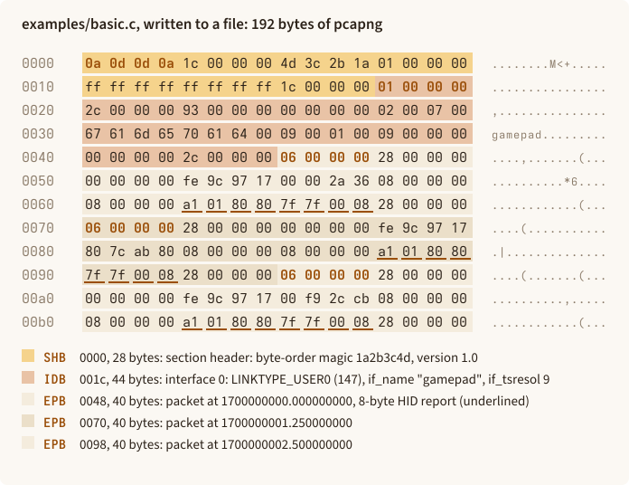

# wirefile

> Read and write pcap and pcapng capture files, the formats Wireshark opens. Streaming reader
> with bounded memory, no stdio required.

[Releases](https://github.com/augustoflorentino/wirefile/releases) · [Changelog](CHANGELOG.md) · [Security](SECURITY.md)

<picture>
  <source media="(prefers-color-scheme: dark)" srcset="docs/images/dump-dark.svg">
  
</picture>

## Build and install

```sh
cmake -S . -B build -DBUILD_SHARED_LIBS=ON
cmake --build build
cmake --install build --prefix /usr/local
```

Use it from CMake:

```cmake
find_package(wirefile REQUIRED)
target_link_libraries(app PRIVATE wirefile::wirefile)
```

Or with pkg-config:

```sh
cc app.c $(pkg-config --cflags --libs wirefile)
```

## Single-file form

`scripts/amalgamate.sh` writes `dist/wirefile/wirefile.h`. Copy it into your project and, in exactly
one `.c` file:

```c
#define PCW_IMPLEMENTATION
#include "wirefile/wirefile.h"
```

Define `PCW_STATIC` as well to keep every function private to that file.

## Usage

See [`examples/basic.c`](examples/basic.c), [`examples/pcwdump.c`](examples/pcwdump.c) and
[`examples/pcwcopy.c`](examples/pcwcopy.c).

Conventions:

- every function that can fail returns `PCW_OK` or a negative error code; `pcw_strerror`
  describes it
- what `pcw_x_create` returns is released only by `pcw_x_destroy`, which accepts `NULL`
- functions never take ownership of their arguments; returned pointers belong to the library
- pass your own allocator to `pcw_reader_create` and `pcw_writer_create`, or `NULL` for
  `malloc`/`free`
- the library does no I/O of its own: it reads and writes through your callbacks

### Reading

```c
pcw_reader_t *reader;
const pcw_block_t *block;
int status;

pcw_reader_create(NULL, NULL, NULL, &reader);
pcw_reader_open_stream(reader, my_read, my_ctx);   /* or pcw_reader_open_mem */
while ((status = pcw_reader_next(reader, &block)) != PCW_END) {
    if (status != PCW_OK)
        continue;                                  /* see "Errors" below */
    if (block->kind == PCW_KIND_PACKET)
        handle(block->ts_sec, block->ts_nsec, block->data, block->data_len);
}
status = pcw_reader_error(reader);                 /* PCW_OK, or why reading stopped */
pcw_reader_destroy(reader);
```

The format (pcap or pcapng, either byte order) is detected from the first bytes.

`my_read(ctx, buf, buf_len, &out_read)` fills up to `buf_len` bytes, sets `out_read` and
returns 0; `out_read == 0` means end of input, a nonzero return is `PCW_ERR_IO`.

`pcw_reader_next` returns one `pcw_block_t` per block. It stays valid until the next call or
`pcw_reader_destroy`. Fields:

| field | meaning |
|---|---|
| `kind` | `PCW_KIND_SECTION`, `INTERFACE`, `PACKET`, `NAMES`, `STATS` or `OTHER` |
| `type` | pcapng block type (`PCW_BLOCK_*`); 0 for pcap |
| `format` | `PCW_FORMAT_PCAP` or `PCW_FORMAT_PCAPNG` |
| `flags` | `PCW_FLAG_TRUNCATED`, `PCW_FLAG_BIG_ENDIAN`, `PCW_FLAG_NO_TIMESTAMP` |
| `section` | section number, from 0 |
| `interface_id`, `linktype`, `snaplen` | the interface the block belongs to |
| `version_major`, `version_minor` | section version |
| `ts_resol` | timestamp resolution as in `if_tsresol`: 6 is micro, 9 is nano, bit 7 set means a power of two |
| `ts_offset` | `if_tsoffset`, in seconds |
| `ts_raw` | timestamp exactly as stored, in `ts_resol` units |
| `ts_sec`, `ts_nsec` | timestamp converted to seconds and nanoseconds, offset included |
| `orig_len` | original packet length |
| `section_len` | section length, -1 when unknown |
| `data`, `data_len` | packet bytes for packets, name records for `NAMES` |
| `options`, `options_len` | the block's raw options |
| `body`, `body_len` | the whole block body as stored, for copying or custom blocks |

A section block comes first, then interfaces before the packets that use them. Simple Packet
Blocks have no timestamp: they carry `PCW_FLAG_NO_TIMESTAMP` and a zero time. Custom and
unknown blocks come back as `PCW_KIND_OTHER` with their body, so you can skip or parse them.

### Options and name records

```c
const unsigned char *value;
size_t len;
size_t pos = 0;
uint16_t code;

if (pcw_option_find(block, PCW_OPT_IF_NAME, &value, &len) == PCW_OK)
    printf("%.*s\n", (int)len, value);
while (pcw_option_next(block, &pos, &code, &value, &len) == PCW_OK)
    ;                                              /* every option, unknown ones too */
```

Both return `PCW_END` when there is nothing more. `pcw_name_next` walks the records of a
`PCW_KIND_NAMES` block the same way. Numbers inside options are in the file's byte order: read
them with `pcw_get_u16`, `pcw_get_u32` and `pcw_get_u64`, which take the block to know it.

`pcw_block_fcs_len(block, &bits)` gives the length in bits of the frame check sequence at the
end of each packet, from the pcap file header, the pcapng `if_fcslen` option or the FCS length
in a packet's `epb_flags`. It returns `PCW_END` when the block does not say.

### Errors and limits

- `PCW_ERR_FORMAT` on a block whose content is broken skips that block, and the next call
  continues; a broken file header, section header, interface block, block length or trailing
  length stops the reader. An error that stops the reader is returned once, every later call
  returns `PCW_END`, and `pcw_reader_error` keeps it; it returns `PCW_OK` while reading goes
  on and when the input ended cleanly or with a truncated packet. So the loop above ends on
  any input, and checking `pcw_reader_error` after it tells a complete read from a stopped
  one
- a file cut in the middle of a packet returns that packet with `PCW_FLAG_TRUNCATED` and
  `data_len` set to what is there, then `PCW_END`; cut anywhere else, `PCW_END` comes at once
  and `pcw_reader_trailing` says how many bytes were left over
- in stream mode the reader allocates one buffer of `max_block_len` bytes (512 KiB by default)
  and a table of up to `max_interfaces` interfaces (1024). Change them with
  `pcw_reader_set_limits` before opening. A larger packet or statistics block is skipped with
  `PCW_ERR_LIMIT` and reading continues; a larger section or interface block, or too many
  interfaces, stops the reader with `PCW_ERR_LIMIT`. An I/O error from your callback stops it
  with `PCW_ERR_IO`
- in memory mode no buffer is allocated and blocks point into your data, so there is no block
  size limit
- `pcw_reader_offset` is the input position after the last block

### Writing

```c
pcw_writer_t *writer;
uint32_t iface;
uint32_t flags = PCW_EPB_INBOUND;
pcw_option_t name = {PCW_OPT_IF_NAME, "hid0", 4};
pcw_option_t direction = {PCW_OPT_EPB_FLAGS, &flags, sizeof(flags)};

pcw_writer_create(NULL, NULL, NULL, &writer);
pcw_writer_open(writer, PCW_FORMAT_PCAPNG, my_write, my_ctx);
pcw_writer_add_interface(writer, PCW_LINKTYPE_USER0, 0, PCW_TSRESOL_NANO, &name, 1, &iface);
pcw_writer_packet(writer, iface, ts_sec, ts_nsec, data, data_len, orig_len, &direction, 1);
pcw_writer_destroy(writer);
```

A new pcapng capture starts its section on the first interface. Call
`pcw_writer_section(writer, options, count)` before it to give the section options
(`PCW_OPT_SHB_USERAPPL`, `PCW_OPT_SHB_OS`, `PCW_OPT_SHB_HARDWARE`, a comment), or later to
start a new section: interfaces are numbered from 0 again in each one. pcap has no sections,
so a pcap writer returns `PCW_ERR_ARG`.

`my_write(ctx, data, data_len)` returns 0 on success. After one failure every writer call
returns `PCW_ERR_IO`. A new file is written in the host byte order; a copied section keeps the
byte order it had.

- the timestamp is stored in the interface resolution, truncated, not rounded; pcap accepts
  only micro and nano and one interface
- `snaplen` is optional (0)
- options are a list of `{code, value, value_len}`, or `NULL, 0` for none. The numbers of the
  options the pcapng spec gives a fixed size (`if_speed`, `if_tzone`, `if_fcslen`,
  `if_txspeed`, `if_rxspeed`, `epb_flags`, `epb_dropcount`, `epb_packetid`, `epb_queue`,
  `epb_processid_threadid`) are given in host byte order and written in the file's; any other
  option, custom ones included, is written as given. `PCW_ERR_ARG`, with nothing written, for
  code 0, a value over 65535 bytes, a fixed size option of another size, and `if_tsresol` or
  `if_tsoffset`, which come from `ts_resol`
- pcap keeps only `if_fcslen`, in the file header; it drops the other options
- `pcw_writer_block` writes a block that a reader returned, so a copy or a conversion is a loop
  of `pcw_reader_next` and `pcw_writer_block`. pcapng to pcapng and pcap to pcap come out
  byte for byte identical. pcap to pcapng gives one section and one interface, and the FCS
  length goes both ways between the pcap header and `if_fcslen`. pcapng to pcap
  keeps the packets under the first interface; it fails with `PCW_ERR_FORMAT` at an
  interface with another link type, and drops options, name records, statistics and custom
  blocks, which pcap cannot hold. Blocks copied from a source in the other byte order, as when
  merging captures from different machines, are rewritten in the writer's order: interfaces,
  packets, name records and statistics keep every option the spec defines, and custom options
  get their enterprise number reordered and their data copied as is, as the spec says. Options,
  name records and blocks of unknown types, `epb_verdict`, and custom blocks are dropped,
  since their bytes cannot be reordered without knowing them. Statistics keep `isb_starttime`
  and `isb_endtime` only when the interface had no `if_tsoffset`
- `pcw_writer_offset` is the number of bytes written so far

### Link types

A pcap file header with any of the reserved link type bits set is rejected with
`PCW_ERR_FORMAT`, as libpcap and Wireshark do. `PCW_LINKTYPE_*` names the ones this library is
tested with: `USER0` to `USER15` (147 to 162,
for raw HID reports), Bluetooth HCI H4 (187, 201 with direction header), Linux usbmon (189,
220) and USBPcap (249). Any other link type passes through unchanged.

### Validation

`ctest` runs unit tests, including an allocation failure at every point, and the
[pcapng-test-generator](tests/data/pcapng-test-generator/SOURCE) corpus in both byte orders,
read whole, in 1 and 13 byte chunks, and copied back byte for byte. `tests/oracle/run.sh`
compares every packet (time, lengths, bytes) with tshark and libpcap on Wireshark's test
captures and on captures generated by `tests/oracle/generate.sh`:

```sh
tests/oracle/fetch.sh build/oracle/ws
tests/oracle/generate.sh build/oracle/gen
tests/oracle/run.sh build build/oracle/ws/* build/oracle/gen/* tests/data/pcapng-test-generator/*/*.pcapng
```

## Versioning

Semantic Versioning. Compatible releases bump the minor version; incompatible ones bump the
major version and the soname. See [CHANGELOG.md](CHANGELOG.md).

## License

MIT, see [LICENSE](LICENSE).
